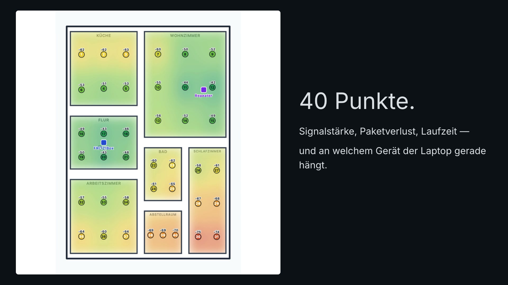
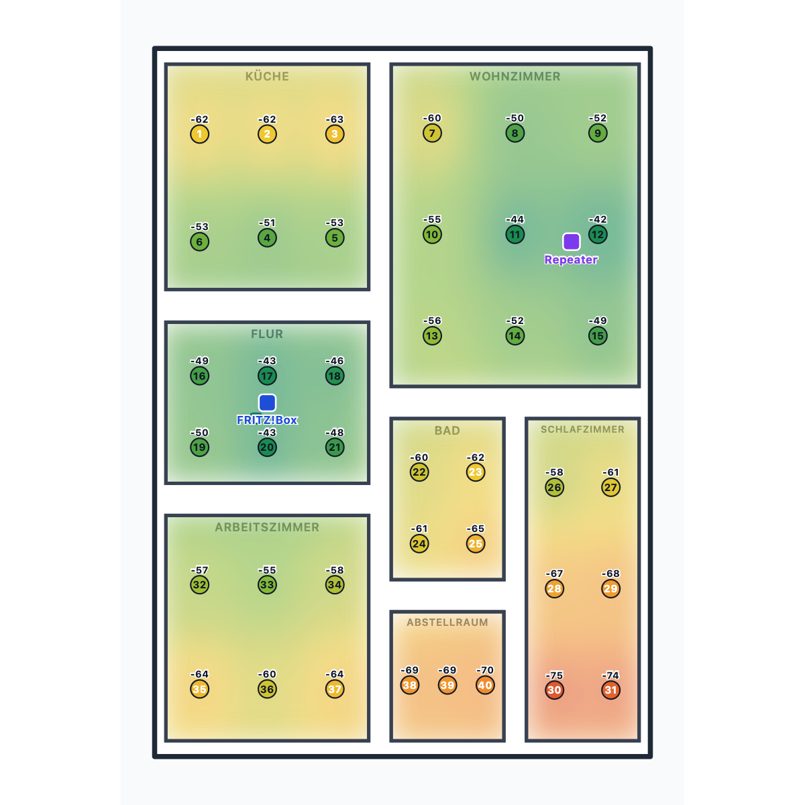
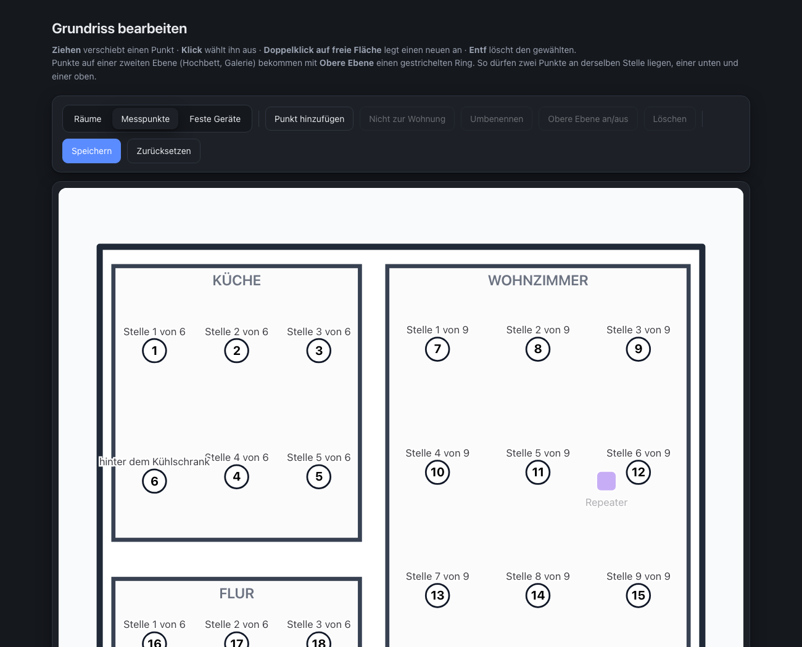

# WifiOptimizer

Findet heraus, warum Videoanrufe zu Hause abreißen — und belegt es mit Zahlen
statt mit Vermutungen.

Das Werkzeug misst die WLAN-Versorgung einer Wohnung, liest parallel die
FRITZ!Box aus und bringt beides zusammen: Was empfängt mein Rechner gerade, an
welchem Zugangspunkt hängt er, und hält die Verbindung überhaupt durch? Das
Ergebnis ist eine Heatmap auf dem Grundriss und ein Bericht mit konkreten
Maßnahmen.

Entstanden ist es aus einem echten Fall: wiederkehrende Aussetzer in
Teams-Anrufen, bei denen Speedtest und Signalstärke unauffällig aussahen. Die
Ursache war am Ende ein Repeater, dessen Netzwerkbuchse alle 40 Sekunden für
vier Sekunden ausfiel — sichtbar nur, weil durchgehend mitgemessen wurde.

[](assets/brag.mp4)

**[▶ Der ganze Fall in sechzig Sekunden](assets/brag.mp4)** — vom eingefrorenen
Anruf über 40 Messpunkte bis zu den beiden Kabelabrissen im Protokoll.

## Inhalt

| | |
|---|---|
| [Was es misst](#was-es-misst) | Signalstärke, Paketverlust, FRITZ!Box-Daten |
| [Messmodi](#messmodi) | fünf Arten zu messen, mit Beispielausgaben |
| [Voraussetzungen](#voraussetzungen) | macOS, FRITZ!Box, sonst nichts |
| [Einrichtung](#einrichtung) | `.env` anlegen, loslegen |
| [Deinen Grundriss einrichten](#deinen-grundriss-einrichten) | Räume zeichnen, Messpunkte setzen |
| [Alle Aufrufe](#alle-aufrufe) | die Befehlsübersicht |
| [Häufige Fragen](#häufige-fragen) | was mit alten Messungen passiert, wohin Daten gehen |
| [Was noch kommt](#was-noch-kommt) · [Was es nicht kann](#was-es-nicht-kann) | Roadmap und Grenzen |

## Was es misst

**Vom Mac**, im Sekundentakt: Signalstärke, Rauschen, Störabstand, Band, Kanal,
Kanalbreite, WLAN-Standard, Übertragungsrate und die Kennung des verbundenen
Zugangspunkts.

**Von der FRITZ!Box**: Mesh-Aufbau, Kanalbelegung aller Funkmodule, das
WLAN-Ereignisprotokoll (inklusive Zwangskanalwechseln durch Radarerkennung),
die Anbindung jedes einzelnen Geräts und der Zustand der Kabelstrecken.

**Für die Anrufqualität**: Laufzeit, Schwankung und Paketverlust, gemessen
getrennt bis zur FRITZ!Box und bis ins Internet. Erst diese Trennung zeigt, ob
ein Problem im Funk liegt oder dahinter.

## Messmodi

| Modus | Wofür |
|---|---|
| **Punktmessung** | An einem Ort stehen bleiben, 15 Sekunden, belastbare Werte |
| **Durchlauf** | Durch die Wohnung laufen, Dauerping findet Abrisse sekundengenau |
| **Diagnose** | Nur die FRITZ!Box auslesen |
| **Heatmap** | Geführt Punkt für Punkt, ergibt die Karte |
| **Schnellblick** | Grobe Karte aus fest installierten Geräten, ohne zu laufen |



Am Messpunkt steht die Signalstärke, die Fläche dazwischen wird interpoliert.
Punkte auf einer zweiten Ebene — Hochbett, Galerie — bekommen einen
gestrichelten Ring, fest installierte Geräte ein Quadrat statt eines Kreises.

### So läuft eine Messung ab

```
$ python3 wlanmess.py

────────────────────────────────────────────────────────────────────────
  WLAN-Messung
────────────────────────────────────────────────────────────────────────
  WLAN                     5GHz, Kanal 48, -63 dBm

  Frage die FRITZ!Box ab ...

────────────────────────────────────────────────────────────────────────
  FRITZ!Box
────────────────────────────────────────────────────────────────────────
  Modell                   FRITZ!Box 7590 AX (FRITZ!OS 259.08.25)
  Laufzeit                 13.9 Tage
  WLAN 2.4GHz              Kanal 1, ax, SSID 'MeinWLAN'
  WLAN 5GHz                Kanal 48, ax, SSID 'MeinWLAN'
  Basis                    fritz.box (FRITZ!Box 7590 AX)
  Kanalwahl                manual
  Steuerung                an

────────────────────────────────────────────────────────────────────────
  Was soll gemessen werden?
────────────────────────────────────────────────────────────────────────
  1  Punktmessung  - an festen Orten stehen bleiben (genau)
  2  Durchlauf     - durch die Wohnung laufen (findet Abrisse)
  3  Nur Diagnose  - FRITZ!Box auslesen, nicht messen
  4  Heatmap       - gefuehrt Punkt fuer Punkt, ergibt eine Karte
  5  Schnellblick  - grobe Karte aus den festen Geraeten, ohne Laufen

  6  Grundriss bearbeiten - Raeume zeichnen, Messpunkte und Geraete setzen

  Auswahl [1-6]: 1

────────────────────────────────────────────────────────────────────────
  Punktmessung
────────────────────────────────────────────────────────────────────────
  Geh zu einem Ort, bleib stehen, gib den Namen ein.
  Leere Eingabe beendet die Messung.

  Ort (leer = fertig): Schreibtisch
  Messe 15 Sekunden - bitte stehen bleiben ... fertig.

  Signal                   █████·····  -61 dBm  (gut, Schwankung -63 bis -61)
  Stoerabstand             28 dB  (gut)
  Verbindung               5GHz, Kanal 48, 80MHz, 680 Mbit/s
  Haengt an                fritz.box (5 GHz, Kanal 48)
  Bis zur FRITZ!Box        gut        alle Werte im gruenen Bereich
  Bis ins Internet         brauchbar  Schwankung 24.3 ms

  >>> Urteil fuer Videoanrufe: BRAUCHBAR
```

Signalstärken, Urteile und Befunde sind farbig — grün, gelb, rot nach den
Richtwerten für Videoanrufe. Wird die Ausgabe in eine Datei oder durch eine
Pipe geleitet, bleiben die Steuerzeichen weg.

### Wenn etwas im Argen liegt

```
────────────────────────────────────────────────────────────────────────
  Befunde
────────────────────────────────────────────────────────────────────────

  1. [kritisch] Das Geraet haengt zu lange am falschen Zugangspunkt
     bei 62s erst bei -80 dBm von fritz.box auf fritz-repeater gewechselt
     (danach -59 dBm); 2 Verbindungsabriss(e) von zusammen 8 Sekunden.
     Massnahme: Bandsteuerung einschalten. Hilft das nicht genug, ist der
     Abstand zwischen den Zugangspunkten zu gross.

  2. [kritisch] Funkmodul auf radarpflichtigem Kanal
     fritz-repeater (AP:5G:1) auf Kanal 116 mit 4 Geraet(en). Wird dort
     ein Radarsignal erkannt, muss das Funkmodul sofort den Kanal wechseln
     - alle daran haengenden Geraete fliegen raus.
     Massnahme: Radarfrei sind nur 36, 40, 44 und 48.
```

### Die Wache findet, was die FRITZ!Box verschweigt

```
$ python3 wlanmess.py --wache 60

  11:38:01  fritz-repeater AP:5G:1: KANALWECHSEL 100 -> 116
  11:43:42  Kabel fritz-repeater: VERBINDUNG WEG
  11:43:51  Kabel fritz-repeater: angesteckt (1000 Mbit an LAN:4)
```

Dazu eine **Wache**, die Ausfälle protokolliert, die die FRITZ!Box selbst nicht
meldet, und ein **Kabeltest** für Netzwerkdosen — mit Kontrollmessung, damit
sich ein Kabelfehler von einer Funkstörung unterscheiden lässt.

## Voraussetzungen

- **macOS** mit Xcode-Befehlszeilenwerkzeugen. Ein kleiner Swift-Helfer wird
  beim ersten Start automatisch übersetzt; er liest die WLAN-Werte in 50
  Millisekunden statt der sechs Sekunden, die `system_profiler` braucht.
- **Eine FRITZ!Box**, erreichbar im Netz, mit aktivierter Anwendungs­schnittstelle
  (*Heimnetz → Netzwerk → Netzwerkeinstellungen → Zugriff für Anwendungen
  zulassen*).
- Sonst nichts. Kein `pip install`, keine Fremdbibliotheken — ausschließlich
  Python-Standardbibliothek.

## Einrichtung

```bash
cp .env.example .env     # und Zugangsdaten eintragen
python3 wlanmess.py
```

Die `.env`:

```
FRITZBOX_HOST=fritz.box
FRITZBOX_USER=<Benutzername>
FRITZBOX_PASSWORT=<Passwort>
```

## Deinen Grundriss einrichten

Der mitgelieferte Plan ist ein Beispiel. Bis deine eigene Wohnung drinsteht,
sind es drei Schritte — Räume von Hand, alles andere im Browser.

### 1. Räume eintragen

Räume sind Rechtecke in `grundriss/plan.json`. Alle Werte sind **Anteile**
zwischen 0 und 1, nicht Meter: `0` ist links beziehungsweise oben, `1` rechts
beziehungsweise unten.

```json
{ "name": "Küche", "x1": 0.10, "y1": 0.07, "x2": 0.48, "y2": 0.31 }
```

Vorgehen, das sich bewährt hat:

1. **Seitenverhältnis festlegen.** `"seitenverhaeltnis": 0.56` heißt, die
   Wohnung ist etwa halb so breit wie lang. Grob schätzen genügt.
2. **Gitternetz einblenden** und den Browser offen lassen — oder gleich den
   Editor benutzen, siehe unten:
   ```bash
   python3 wlanmess.py --karte --raster
   open grundriss/messpunkte.html
   ```
   Das zeichnet ein beschriftetes Gitter in Zehntelschritten über den Plan.
3. **Raum für Raum eintragen**, nach jedem Raum den Befehl erneut laufen
   lassen und die Seite neu laden. Nach zwei, drei Räumen hat man das Gefühl
   für die Zahlen.

Du brauchst keinen Architektenplan. Es genügt, dass die Räume ungefähr richtig
groß sind und richtig aneinandergrenzen — gemessen wird ja das Funkfeld, nicht
die Wohnung.

Nützliche Zusätze:

| Feld | Wofür |
|---|---|
| `"extern": true` | Räume, die nicht zur Wohnung gehören (Treppenhaus) — werden grau |
| `teilflaechen` | Bereiche innerhalb eines Raums, etwa ein Hochbett |
| `dosen` | Netzwerkdosen, als Anhaltspunkt für Repeater-Standorte |
| `geraete` | Router und Repeater |

### Vorlage zum Abzeichnen

Leg ein Foto oder einen Scan deines Grundrisses als **`grundriss/vorlage.jpg`**
ab (auch `.jpeg` oder `.png`). Der Editor blendet es hinter dem Plan ein, und
du zeichnest die Räume einfach darüber nach. Das Bild wird nur im Editor
angezeigt, nie in einer Heatmap — und es bleibt lokal, der Editor läuft auf
`127.0.0.1`.

### 2. Räume, Messpunkte und Geräte setzen

```bash
python3 wlanmess.py --bearbeiten
```

oder im Hauptmenü **Punkt 6**.



Öffnet einen Editor im Browser mit drei Reitern.

**Räume** — auf freier Fläche aufziehen legt einen Raum an, Ziehen verschiebt
ihn, an der rechten unteren Ecke ändert sich die Größe. „Nicht zur Wohnung"
färbt Treppenhäuser grau und nimmt sie aus der Messung.

**Messpunkte** — in jedem Raum liegt automatisch ein Raster. Die ziehst du
dorthin, wo du tatsächlich sitzt, stehst und telefonierst.

- **Ziehen** verschiebt, **Doppelklick** legt einen neuen Punkt an,
  **Entf** löscht
- **Umbenennen** gibt sinnvolle Namen („am Herd" statt „Stelle 3 von 8")
- **Obere Ebene** für Punkte auf einem Hochbett oder einer Galerie — damit
  dürfen zwei Punkte an derselben Stelle liegen
- Reiter **Feste Geräte**: Lautsprecher, Fernseher, Konsole platzieren, dazu
  Router und Repeater verschieben

Gespeichert wird direkt in `plan.json`.

### 3. Später etwas ändern

**Am Plan zu arbeiten ist gefahrlos.** Jede Messung speichert den Grundriss
mit, der zum Zeitpunkt der Messung galt. Räume verschieben, Punkte löschen,
die ganze Wohnung umbauen — alte Messungen zeigen weiterhin ihren eigenen
Stand und bleiben unverändert.

Das heißt aber auch: Sie liegen dann auf einem anderen Raster als neue
Messungen und lassen sich nicht mehr Punkt für Punkt vergleichen. Dafür gibt
es:

```bash
python3 wlanmess.py --umhaengen messungen/<ordner>
```

Das ordnet jeden alten Messwert dem passenden Punkt der neuen Anordnung zu —
zuerst über den Namen, dann über die Entfernung. Was weiter als etwa einen
Meter gewandert ist, bleibt unzugeordnet und wird genannt, statt
stillschweigend falsch übernommen zu werden.

**Was dabei mit den Daten passiert:**

| | |
|---|---|
| Punkt nur verschoben | Messwert wandert mit, bleibt erhalten |
| Punkt umbenannt | wird über die Entfernung wiedergefunden |
| Punkt gelöscht | Messwert fällt aus `messung.json` heraus |
| Punkt neu angelegt | bleibt leer, bis du dort misst |

`--umhaengen` schreibt direkt in `messung.json`. Vorher legt es einmalig
`messung-original.json` daneben — und überschreibt diese Sicherung nie, auch
bei mehrfachem Umhängen nicht. Zurück geht es mit:

```bash
python3 wlanmess.py --zuruecksetzen messungen/<ordner>
```

Es geht also nichts verloren, solange du den Messordner nicht von Hand
aufräumst.

## Alle Aufrufe

```bash
python3 wlanmess.py                      # Messmodi zur Auswahl
python3 wlanmess.py --bearbeiten         # Messpunkte und Geräte im Browser
python3 wlanmess.py --karte [--raster]   # Messpunktkarte, auf Wunsch mit Gitternetz
python3 wlanmess.py --geraete            # wer hängt wo im Netz
python3 wlanmess.py --funkkarte          # Karte aus festen Geräten
python3 wlanmess.py --wache [min] [s]    # Netz beobachten, Ausfälle festhalten
python3 wlanmess.py --kabeltest [gerät]  # Netzwerkdose prüfen
python3 wlanmess.py --leitung [min]      # eigene Leitung zur FRITZ!Box messen
python3 wlanmess.py --vergleich <a> <b>  # zwei Messungen gegenüberstellen
python3 wlanmess.py --uebersicht         # Vergleichsseite für alle Rundgänge
python3 wlanmess.py --umhaengen <ordner> # Messung auf geänderte Punkte legen
python3 wlanmess.py --zuruecksetzen <o>  # Umhängen rückgängig machen
python3 wlanmess.py --neu <ordner>       # Messung neu auswerten
python3 wlanmess.py --standort           # Ortungsfreigabe anfordern
```

## Häufige Fragen

**Was passiert mit alten Messungen, wenn ich den Grundriss ändere?**
Nichts. Jede Messung speichert den Grundriss mit, der zum Zeitpunkt der
Messung galt, und zeigt ihn weiterhin. Erst `--umhaengen` schreibt in eine
Messung — und legt vorher eine Sicherung an, die `--zuruecksetzen`
zurückholt.

**Warum sehe ich in der Vergleichsseite nur manche Läufe?**
Vergleichbar sind nur Rundgänge (Modus 4), und nur solche mit denselben
Messpunkten. Liegen zwei Läufe auf verschiedenen Rastern, hilft
`--umhaengen`.

**Muss ich bei jeder Messung alle Punkte abgehen?**
Nein. Mit `s` überspringst du einen Punkt. Übersprungene bleiben leer und
tauchen im Vergleich als „kein Messwert" auf, statt das Ergebnis zu
verfälschen.

**Werden meine Daten irgendwohin geschickt?**
Nein. Alles bleibt auf dem Rechner, der Editor läuft auf `127.0.0.1`. Nach
außen geht nur, was ohnehin im Heimnetz passiert: Abfragen an die FRITZ!Box
und Pings an einen Namensserver, um die Internetstrecke zu messen.

**Die Werte schwanken zwischen zwei Messungen am selben Ort.**
Das ist normal, drei bis fünf dB Unterschied sind üblich — schon die eigene
Körperhaltung wirkt sich aus. Vergleiche deshalb nie einzelne Punkte,
sondern ganze Räume, und miss im selben Zustand (Akku oder Netzteil).

## Was noch kommt

- **Die Weboberflächen verständlicher machen.** Editor und Vergleichsseite
  funktionieren, erklären sich aber noch zu wenig von selbst — bessere
  Beschriftungen, sichtbarere Werkzeuge, eine kurze Einführung beim ersten
  Öffnen.
- **Grundriss maßstäblich.** Derzeit sind alle Angaben Anteile von 0 bis 1.
  Mit echten Metern ließe sich die Dämpfung pro Wand abschätzen.
- **Mehrere Etagen.** Eine zweite Ebene lässt sich markieren, aber nicht als
  eigener Grundriss führen.
- **Empfehlung für den Repeater-Standort** aus den Messdaten berechnen,
  statt sie von Hand abzulesen.

## Was es nicht kann

- **Nur macOS.** Der Helfer nutzt CoreWLAN.
- **Nur FRITZ!Box.** Die halbe Aussagekraft kommt aus deren Mesh-Daten.
- **Keine Höhenmessung.** Eine zweite Ebene (Hochbett, Galerie) lässt sich
  markieren, aber der Grundriss bleibt zweidimensional.
- **Die Werte fester Geräte sind untereinander nicht vergleichbar.** Ein
  Lautsprecher sendet schwächer als ein Laptop. Für denselben Ort über die Zeit
  taugen sie, für den Vergleich zweier Orte nicht.

## Lizenz

MIT — siehe [LICENSE](LICENSE).
