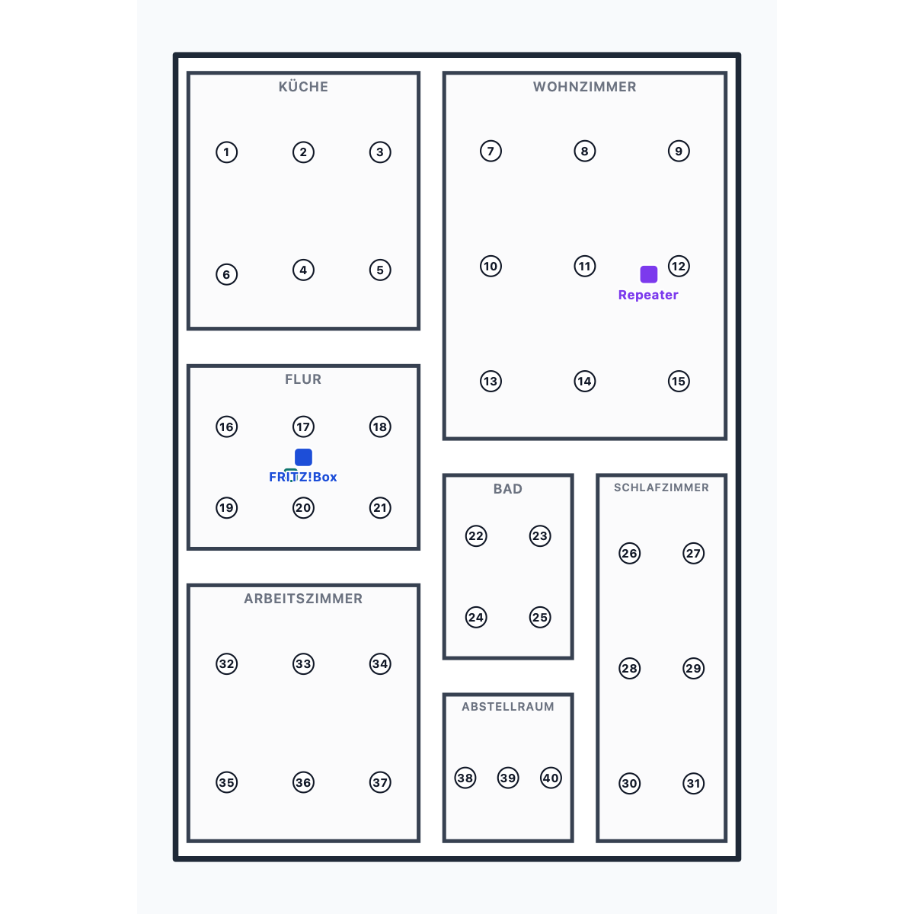

# WifiOptimizer

Findet heraus, warum Videoanrufe zu Hause abreißen — und belegt es mit Zahlen
statt mit Vermutungen.

Das Werkzeug misst die WLAN-Versorgung einer Wohnung, liest parallel die
FRITZ!Box aus und bringt beides zusammen: Was empfängt mein Rechner gerade, an
welchem Zugangspunkt hängt er, und hält die Verbindung überhaupt durch? Das
Ergebnis ist eine Heatmap auf dem Grundriss und ein Bericht mit konkreten
Maßnahmen.

Entstanden ist es aus einem echten Fall: wiederkehrende Aussetzer in
Teams-Anrufen, bei denen Speedtest und Signalstärke unauffällig aussahen. Die
Ursache war am Ende ein Repeater, dessen Netzwerkbuchse alle 40 Sekunden für
vier Sekunden ausfiel — sichtbar nur, weil durchgehend mitgemessen wurde.


Am Messpunkt steht die Signalstärke, die Fläche dazwischen wird interpoliert.
Punkte auf einer zweiten Ebene — Hochbett, Galerie — bekommen einen
gestrichelten Ring, fest installierte Geräte ein Quadrat statt eines Kreises.

## Was es misst

**Vom Mac**, im Sekundentakt: Signalstärke, Rauschen, Störabstand, Band, Kanal,
Kanalbreite, WLAN-Standard, Übertragungsrate und die Kennung des verbundenen
Zugangspunkts.

**Von der FRITZ!Box**: Mesh-Aufbau, Kanalbelegung aller Funkmodule, das
WLAN-Ereignisprotokoll (inklusive Zwangskanalwechseln durch Radarerkennung),
die Anbindung jedes einzelnen Geräts und der Zustand der Kabelstrecken.

**Für die Anrufqualität**: Laufzeit, Schwankung und Paketverlust, gemessen
getrennt bis zur FRITZ!Box und bis ins Internet. Erst diese Trennung zeigt, ob
ein Problem im Funk liegt oder dahinter.

## Messmodi

| Modus | Wofür |
|---|---|
| **Punktmessung** | An einem Ort stehen bleiben, 15 Sekunden, belastbare Werte |
| **Durchlauf** | Durch die Wohnung laufen, Dauerping findet Abrisse sekundengenau |
| **Diagnose** | Nur die FRITZ!Box auslesen |
| **Heatmap** | Geführt Punkt für Punkt, ergibt die Karte |
| **Schnellblick** | Grobe Karte aus fest installierten Geräten, ohne zu laufen |

So sieht eine Punktmessung aus:

```
  Signal          ████·······  -71 dBm  (grenzwertig, Schwankung -73 bis -68)
  Stoerabstand    18 dB  (grenzwertig)
  Verbindung      5GHz, Kanal 48, 80MHz, 272 Mbit/s
  Haengt an       fritz-repeater (5 GHz, Kanal 116)
  Bis zur FRITZ!Box   kritisch   Paketverlust 25.3 % (zu hoch)
  Bis ins Internet    kritisch   Paketverlust 25.3 % (zu hoch)

  >>> Urteil fuer Videoanrufe: KRITISCH
```

Grün, gelb und rot richten sich nach den Richtwerten für Videoanrufe. In eine
Datei umgeleitet bleiben die Farbcodes weg.

Dazu eine **Wache**, die Ausfälle protokolliert, die die FRITZ!Box selbst nicht
meldet, und ein **Kabeltest** für Netzwerkdosen — mit Kontrollmessung, damit
sich ein Kabelfehler von einer Funkstörung unterscheiden lässt.

## Voraussetzungen

- **macOS** mit Xcode-Befehlszeilenwerkzeugen. Ein kleiner Swift-Helfer wird
  beim ersten Start automatisch übersetzt; er liest die WLAN-Werte in 50
  Millisekunden statt der sechs Sekunden, die `system_profiler` braucht.
- **Eine FRITZ!Box**, erreichbar im Netz, mit aktivierter Anwendungs­schnittstelle
  (*Heimnetz → Netzwerk → Netzwerkeinstellungen → Zugriff für Anwendungen
  zulassen*).
- Sonst nichts. Kein `pip install`, keine Fremdbibliotheken — ausschließlich
  Python-Standardbibliothek.

## Einrichtung

```bash
cp .env.example .env     # und Zugangsdaten eintragen
python3 wlanmess.py
```

Die `.env`:

```
FRITZBOX_HOST=fritz.box
FRITZBOX_USER=<Benutzername>
FRITZBOX_PASSWORT=<Passwort>
```

## Deinen Grundriss einrichten

Der mitgelieferte Plan ist ein Beispiel. Bis deine eigene Wohnung drinsteht,
sind es drei Schritte — Räume von Hand, alles andere im Browser.

### 1. Räume eintragen

Räume sind Rechtecke in `grundriss/plan.json`. Alle Werte sind **Anteile**
zwischen 0 und 1, nicht Meter: `0` ist links beziehungsweise oben, `1` rechts
beziehungsweise unten.

```json
{ "name": "Küche", "x1": 0.10, "y1": 0.07, "x2": 0.48, "y2": 0.31 }
```

Vorgehen, das sich bewährt hat:

1. **Seitenverhältnis festlegen.** `"seitenverhaeltnis": 0.56` heißt, die
   Wohnung ist etwa halb so breit wie lang. Grob schätzen genügt.
2. **Gitternetz einblenden** und den Browser offen lassen — oder gleich den
   Editor benutzen, siehe unten:
   ```bash
   python3 wlanmess.py --karte --raster
   open grundriss/messpunkte.html
   ```
   Das zeichnet ein beschriftetes Gitter in Zehntelschritten über den Plan.
3. **Raum für Raum eintragen**, nach jedem Raum den Befehl erneut laufen
   lassen und die Seite neu laden. Nach zwei, drei Räumen hat man das Gefühl
   für die Zahlen.

Du brauchst keinen Architektenplan. Es genügt, dass die Räume ungefähr richtig
groß sind und richtig aneinandergrenzen — gemessen wird ja das Funkfeld, nicht
die Wohnung.

Nützliche Zusätze:

| Feld | Wofür |
|---|---|
| `"extern": true` | Räume, die nicht zur Wohnung gehören (Treppenhaus) — werden grau |
| `teilflaechen` | Bereiche innerhalb eines Raums, etwa ein Hochbett |
| `dosen` | Netzwerkdosen, als Anhaltspunkt für Repeater-Standorte |
| `geraete` | Router und Repeater |

### Vorlage zum Abzeichnen

Leg ein Foto oder einen Scan deines Grundrisses als **`grundriss/vorlage.jpg`**
ab (auch `.jpeg` oder `.png`). Der Editor blendet es hinter dem Plan ein, und
du zeichnest die Räume einfach darüber nach. Das Bild wird nur im Editor
angezeigt, nie in einer Heatmap — und es bleibt lokal, der Editor läuft auf
`127.0.0.1`.

### 2. Räume, Messpunkte und Geräte setzen

```bash
python3 wlanmess.py --bearbeiten
```



Öffnet einen Editor im Browser mit drei Reitern.

**Räume** — auf freier Fläche aufziehen legt einen Raum an, Ziehen verschiebt
ihn, an der rechten unteren Ecke ändert sich die Größe. „Nicht zur Wohnung"
färbt Treppenhäuser grau und nimmt sie aus der Messung.

**Messpunkte** — in jedem Raum liegt automatisch ein Raster. Die ziehst du
dorthin, wo du tatsächlich sitzt, stehst und telefonierst.

- **Ziehen** verschiebt, **Doppelklick** legt einen neuen Punkt an,
  **Entf** löscht
- **Umbenennen** gibt sinnvolle Namen („am Herd" statt „Stelle 3 von 8")
- **Obere Ebene** für Punkte auf einem Hochbett oder einer Galerie — damit
  dürfen zwei Punkte an derselben Stelle liegen
- Reiter **Feste Geräte**: Lautsprecher, Fernseher, Konsole platzieren, dazu
  Router und Repeater verschieben

Gespeichert wird direkt in `plan.json`.

### 3. Später etwas ändern

Verschiebst du Messpunkte nach einer Messung, passen alte Ergebnisse nicht
mehr zu den neuen Positionen. Dafür gibt es:

```bash
python3 wlanmess.py --umhaengen messungen/<ordner>
```

Das ordnet jeden alten Messwert wieder dem richtigen Punkt zu — zuerst über
den Namen, dann über die Entfernung. Was zu weit gewandert ist, bleibt
unzugeordnet und wird genannt, statt stillschweigend falsch übernommen zu
werden. Das Original wird vorher gesichert.

## Alle Aufrufe

```bash
python3 wlanmess.py                      # Messmodi zur Auswahl
python3 wlanmess.py --bearbeiten         # Messpunkte und Geräte im Browser
python3 wlanmess.py --karte [--raster]   # Messpunktkarte, auf Wunsch mit Gitternetz
python3 wlanmess.py --geraete            # wer hängt wo im Netz
python3 wlanmess.py --funkkarte          # Karte aus festen Geräten
python3 wlanmess.py --wache [min] [s]    # Netz beobachten, Ausfälle festhalten
python3 wlanmess.py --kabeltest [gerät]  # Netzwerkdose prüfen
python3 wlanmess.py --leitung [min]      # eigene Leitung zur FRITZ!Box messen
python3 wlanmess.py --vergleich <a> <b>  # zwei Messungen gegenüberstellen
python3 wlanmess.py --uebersicht         # Vergleichsseite für alle Rundgänge
python3 wlanmess.py --umhaengen <ordner> # Messung auf geänderte Punkte legen
python3 wlanmess.py --neu <ordner>       # Messung neu auswerten
python3 wlanmess.py --standort           # Ortungsfreigabe anfordern
```

## Was es nicht kann

- **Nur macOS.** Der Helfer nutzt CoreWLAN.
- **Nur FRITZ!Box.** Die halbe Aussagekraft kommt aus deren Mesh-Daten.
- **Keine Höhenmessung.** Eine zweite Ebene (Hochbett, Galerie) lässt sich
  markieren, aber der Grundriss bleibt zweidimensional.
- **Die Werte fester Geräte sind untereinander nicht vergleichbar.** Ein
  Lautsprecher sendet schwächer als ein Laptop. Für denselben Ort über die Zeit
  taugen sie, für den Vergleich zweier Orte nicht.

## Lizenz

MIT — siehe [LICENSE](LICENSE).
